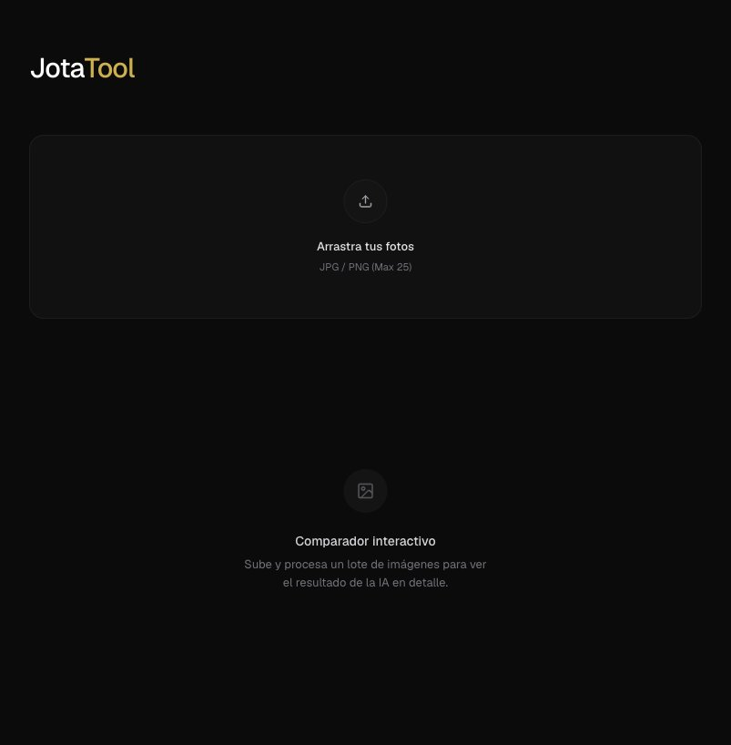

# JotaTool: la primera versión de Plinth

JotaTool fue el primer prototipo de lo que hoy es [Plinth](https://app.plinth.lat), la PWA que uso con un asesor inmobiliario para publicar propiedades. Resolvía un problema puntual: sacar marcas de agua y textos de lotes de fotos de propiedades antes de publicarlas.



Este repo queda como registro de esa primera etapa. El desarrollo sigue en Plinth, que reemplazó el backend por procesamiento dentro del navegador.

## Cómo funcionaba

- **Frontend (Next.js 14):** carga de hasta 25 imágenes, barra de progreso, comparador antes/después y descarga de todo en un ZIP. Pensado primero para el celular, con el menú de compartir de iOS.
- **Backend (FastAPI, con configuración para Render):** cola que procesa una imagen por vez y avisa el progreso por Server-Sent Events.
- **Pipeline de limpieza** (`backend/main.py`), que fue cambiando en cada iteración:
  1. Primero, inpainting con Gemini y un respaldo local con OpenCV.
  2. Después, Clipdrop Cleanup con una máscara armada con OpenCV. Inventaba detalles en los bordes.
  3. Al final: Clipdrop Remove Text (sin máscara) → detección de logos con OWL-ViT (Hugging Face) → Clipdrop Cleanup solo sobre lo detectado.

## Qué aprendí y llevé a Plinth

- Encadenar tres APIs externas por foto sumaba demoras y puntos de falla (hubo que comprimir las imágenes para evitar timeouts). En Plinth el procesamiento pasó al navegador.
- Las máscaras grandes hacen que el modelo invente fondo; conviene detectar primero y borrar solo lo necesario.

## Cómo correrlo

```bash
# Backend
cd backend
python3 -m venv venv && source venv/bin/activate
pip install -r requirements.txt
export CLIPDROP_API_KEY=...   # y HF_API_TOKEN para la detección de logos
python main.py                # http://localhost:8000

# Frontend (otra terminal)
cd frontend
npm install
npm run dev                   # http://localhost:3000
```

## Derechos

© 2026 Ramiro Mauer. Todos los derechos reservados. El código está publicado para que se pueda leer; no se otorga licencia para usarlo, copiarlo ni distribuirlo.
